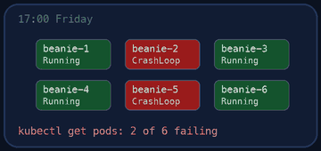
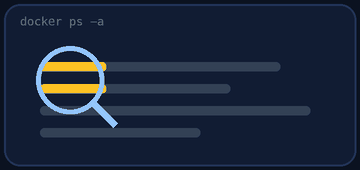
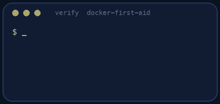

<p align="center"></p>

| | |
|-|-|
| **Time** | 60-75 min |
| **Cost** | free |
| **You need** | Docker (Docker Desktop, OrbStack, or Docker Engine in WSL/Ubuntu) and a terminal |

## How this lab works

1. **Fork** this repository to your own GitHub account (button at the top right).
2. Clone **your fork** in your Ubuntu environment (WSL on Windows, your OrbStack machine on Mac).
3. Read the lab below (the same text is in [`LAB.md`](LAB.md)) and follow the mission.
4. Answer the questions in [`SUBMISSION.md`](SUBMISSION.md). Where a question asks for output, paste it in a code block. No screenshots needed.
5. Commit and push. Open the **Actions** tab of your fork (click *I understand my workflows, go ahead and enable them* the first time). The **Lab check** shows what is still missing.
6. When the check is green, **submit the URL of your fork** in the course platform.

> [!NOTE]
> The check only looks at your answers and any files the lab asks you to commit. Your instructor reads your work and may ask you to explain any line.

<p align="center"></p>

## 🎬 The situation

<p align="center"></p>

```text
TRIAGE BOARD - the shared dev box              17:00, you are the only one left
-------------------------------------------------------------------------------
BED            ARRIVED AS             FIRST IMPRESSION
fa-db          "it was running"       ?
fa-web         "it was running"       ?
fa-crashloop   "keeps coming back"    ?
fa-chatty      "very loud"            fan screaming
(two more beds, not on the board: nobody knows what they hold)
-------------------------------------------------------------------------------
Rule of the ward: examine before you treat.
```

A colleague who left last week ran the pieces of the polls application on this box as Docker containers, and wrote nothing down. The staging smoke test is red. You will not read any code: you have the Docker CLI, a ward full of containers in different states, and one rule: **find out before you fix**.

> [!IMPORTANT]
> **Your mission**
> - Look at the box and work out what is wrong with each `fa-` container, from evidence only
> - Fix every one of them (the database, the website, the crash-looping worker and the noisy neighbour)
> - Interrogate a container you know nothing about
> - Leave the box clean, then prove it

**Time:** 60-75 min | **Cost:** free | **You need:** Docker running on your machine (Docker Desktop, OrbStack, or Docker Engine on Ubuntu/WSL) and a terminal. `./teardown.sh` removes the lab.

<p align="center"></p>

## Admission - Set the scene

Fork this repository, clone your fork, and run:

```bash
./setup.sh
```

It pulls a few small images and starts the broken containers, all named `fa-...` and labelled `lab=docker-first-aid`. Read the table it prints, then forget it: you will look for yourself.

<p align="center"></p>

## Part 1 - Examine (look before you touch)

<p align="center"></p>

Do not change anything yet. Answer from what you see.

1. `docker ps` shows what is running. `docker ps -a` shows everything. **What is the difference, and what does the second one reveal?**
2. For each container, which *state* is it in (`running`, `exited`, `created`, `restarting`)? What does the exit code in `Exited (N)` tell you?
3. `docker logs <name>` is the first thing an engineer reads. Read the logs of **every** container, including the ones that look fine. Add `--tail 5` for the noisy one, or your terminal will drown.
4. `docker stats --no-stream`: which container uses the most CPU? Is that the one you expected?
5. `docker inspect <name>` prints everything Docker knows. Find, for `fa-crashloop`: the environment variables, the restart policy and `RestartCount`. Tip: `docker inspect -f '{{.RestartCount}}' fa-crashloop`.

> [!NOTE]
> **Predict** Run `docker inspect -f '{{.RestartCount}}' fa-crashloop`, wait a minute, run it again. Will the number change? By how much? Write your guess down, then check.

Write what you learn in `notes.md` as you go (one line per container).

<p align="center"></p>

## Part 2 - Treat the patients

Fix them one at a time and test each one before you move on. `./verify.sh` shows progress at any time.

### 2.1 The database that never started

`fa-db` is `Exited`. The logs tell you exactly why. Docker containers are cheap to recreate: remove it and run it again with what it needs. Find in the logs which environment variable is required (`-e NAME=value`).

> [!TIP]
> **Checkpoint** `docker exec fa-db pg_isready -U postgres` says `accepting connections`.

### 2.2 The website that cannot start

`fa-web` is `Created` (it was never able to start). Try `docker start fa-web` and read the error. Then find out **who** holds the port (`docker ps`, `docker port <name>`), decide whether it is safe to remove, and bring the new site up on port **8080** under the same name `fa-web`.

> [!TIP]
> **Checkpoint** `curl localhost:8080` prints `NEW SITE`. (A container's published port is a host resource: only one process can have it.)

### 2.3 The worker that restarts forever

`fa-crashloop` is stuck in a loop because of a `--restart always` policy. Read its logs. The fix is a configuration value it never received. Recreate it (same name) with the missing environment variable pointing at the database container: the value is the **name** `fa-db`.

> [!NOTE]
> **Think** Docker restarted this container hundreds of times and never complained. What would you have seen on a monitoring dashboard? Why is a restart policy a *safety net* and not a *fix*?

### 2.4 The noisy neighbour

`fa-chatty` prints a line as fast as it can. Find it with `docker stats`, look at its logs with `--tail`, and stop it. Do **not** just leave it stopped: the colleague meant it to be a worker. Remove it and start a new container called `fa-worker` (any small image, for example `alpine:3.20 sleep 86400`) that behaves like a good citizen:

| Setting | Requirement | Flag |
|---------|-------------|------|
| Memory | capped | `--memory` |
| CPU | capped | `--cpus` |
| Logs | rotated, small | `--log-opt max-size=... --log-opt max-file=...` |
| Restarts | after a crash or reboot, but not after you stop it on purpose | `--restart unless-stopped` |
| Label | so teardown finds it | `--label lab=docker-first-aid` |

> [!WARNING]
> **Break it** Predict, then try: `docker kill fa-worker`. Does the restart policy bring it back? Then `docker start fa-worker`. What does that tell you about what `unless-stopped` means? Compare with `fa-crashloop`, which restarted by itself.

<p align="center"></p>

## Part 3 - Interrogate a stranger

`fa-mystery` is healthy and nobody knows what it is. You may use only `docker inspect`, `docker exec`, `docker port`, `docker logs` and `docker stats`.

1. Which image and which version? (`docker inspect`, then `docker exec fa-mystery redis-server --version`)
2. Which user runs the main process? (`docker exec fa-mystery ps`, `docker exec fa-mystery id`)
3. Which port does it listen on **inside** the container and on which port of **your machine** is it published? (`docker port fa-mystery`)
4. What is the value of the `RELEASE` environment variable?
5. Get a shell inside it (`docker exec -it fa-mystery sh`) and look around. Which files does the process use? Exit with `exit`.

> [!NOTE]
> **Think** `docker exec` ran a *new* process inside the container's namespaces. Why is that different from SSH-ing into a server, and why should you not make changes in there that you want to keep?

<p align="center"></p>

## Part 4 - Prove it

<p align="center"></p>

Fill in `notes.md` (one real sentence per container, at least 20 characters), then:

```bash
./verify.sh
```

Fix what is red and run it again until it ends with **ALL CHECKS PASSED**.

> [!TIP]
> **Stuck?** Containers are disposable. When in doubt: `docker rm -f NAME` and run it again with the right options. The causes here are a missing `-e`, a port that is taken and limits nobody set. Nothing needs more than `docker run`, `docker rm`, `docker logs` and `docker inspect`.

<p align="center"></p>

## Level up (optional)

The same investigation in one line each: `docker ps -a --format 'table {{.Names}}\t{{.Status}}\t{{.Ports}}'`, `docker system df` (how much space images, containers and volumes use), `docker events` in a second terminal while you break things. Where would you see "this container died 3 times today" in a real company? (Hint: the next weeks.)

<!-- teardown:start (generated by labs.py, do not edit) -->
## Tear down (mandatory)

<p align="center"></p>

Resources left behind cost money, keep doors open and pollute the next lab. Removing what you created is part of the job, so it is part of the submission: **you must prove it is gone**.

Do this **last**, after you have pasted your `verify` output into `SUBMISSION.md` (once you tear down, the lab can no longer be verified).

1. Run `./teardown.sh`. It removes every container, network and volume the lab created (all labelled `lab=docker-first-aid`). The images stay, they are only a cache.

Then run the proof:

```bash
./verify-teardown.sh
```

It prints a list of checks and must end with **TEARDOWN VERIFIED**. If it reports leftovers, remove them and run it again. Paste the full output in your submission.
<!-- teardown:end -->

<!-- submission:start (generated by labs.py, do not edit) -->
## 📬 Submission

Answer the questions in `SUBMISSION.md` in **your fork** (paste output in code blocks where asked), push, then submit the **URL of your fork**.

**Files to commit**

- `notes.md`: your diagnosis, one line per container, committed to the repo

**Questions to answer**

1. Paste `docker ps -a` as you first saw it. For each of the five `fa-` containers that was not healthy: its state, and the root cause in one sentence.
2. `fa-crashloop` kept restarting. Paste its `RestartCount` at two moments and the log line that explains it. Why does `--restart` make this kind of failure harder to notice?
3. Starting `fa-web` failed. Paste the exact error and the command that showed you who was holding port 8080. Why can two containers not publish the same host port?
4. Paste the `docker stats` line that identified the noisy container and the flags you used on the replacement worker (memory, CPU, log rotation, restart policy). What would have happened to the disk if nobody noticed for a month?
5. About `fa-mystery`, using only `docker inspect`, `docker exec` and `docker port`: which image and version, which user runs the main process, which port it listens on inside the container and which on your host, and what is the value of its `RELEASE` environment variable? Paste the commands you used.
6. What is the difference between `docker stop` and `docker kill`, and between `docker rm` and `docker rm -f`? When would you pick the harsher one?
7. Paste the output of `./verify.sh`. It must end with **ALL CHECKS PASSED**.
8. **Tear down.** Paste the output of `./verify-teardown.sh`. It must end with **TEARDOWN VERIFIED**.
<!-- submission:end -->
